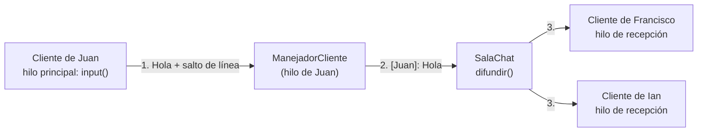

# Chat Multiusuario en Red LAN por Consola

Taller de **Sistemas Distribuidos**: Sockets Multihilo en Python.
Universidad Politécnica Salesiana, Ingeniería en Ciencias de la Computación.

A partir del código base de un servidor de eco, se desarrolló un chat donde varios usuarios de la misma red LAN se conectan a un servidor, se identifican con un alias y conversan en tiempo real desde la consola.

---

## Tabla de contenido

1. [Equipo](#1-equipo)
2. [Estructura del repositorio](#2-estructura-del-repositorio)
3. [Requisitos](#3-requisitos)
4. [Ejecución paso a paso](#4-ejecución-paso-a-paso)
5. [Funcionamiento general](#5-funcionamiento-general)
6. [Protocolo de comunicación](#6-protocolo-de-comunicación)
7. [Servidor](#7-servidor)
8. [Cliente](#8-cliente)
9. [Concurrencia](#9-concurrencia)
10. [Principios SOLID aplicados](#10-principios-solid-aplicados)
11. [Manejo de errores](#11-manejo-de-errores)
12. [Limitaciones conocidas](#12-limitaciones-conocidas)
13. [Documentación del trabajo en equipo](#13-documentación-del-trabajo-en-equipo)

---

## 1. Equipo

| Integrante | Rol | Entregable |
|---|---|---|
| Ian Mena | Líder del equipo | `protocolo.py`, integración, README final, bitácora del líder |
| Juan Nuñez | Desarrollador del servidor | `servidor_chat.py` y su documentación |
| Francisco Urgiles | Desarrollador del cliente | `cliente_chat.py` y su documentación |

El detalle de responsabilidades está en [`docs/`](docs/).

---

## 2. Estructura del repositorio

```
├── README.md
├── .gitignore
├── chat/                         # Código final del chat
│   ├── protocolo.py              # Reglas comunes: delimitador, lector de mensajes y formateadores
│   ├── servidor_chat.py          # Servidor de difusión multihilo
│   └── cliente.py           # Cliente concurrente de dos hilos
├── codigo_base/                  # Código original del servidor de eco (referencia)
│   ├── serverMH.py
│   └── clientMH.py
└── docs/                         # Documentación del trabajo en equipo
    ├── 01_responsabilidades.pdf
    ├── 02_acta.pdf
    ├── 03_bitacora_lider.pdf
    └── evidencias/               # Capturas de la prueba en LAN
        ├── server.png            # Consola del servidor con conexiones y desconexiones
        └── cliente.png           # Consolas de los clientes conversando
```

---

## 3. Requisitos

- Python 3.8 o superior. No se usan librerías externas, solo la biblioteca estándar (`socket`, `threading`, `logging`, `abc`).
- Dos o más computadoras conectadas a la **misma red** (Wi-Fi o cable). Para pruebas locales basta una computadora con varias terminales.
- Los tres archivos de `chat/` deben estar en la **misma carpeta**, porque el servidor y el cliente importan `protocolo.py`.

---

## 4. Ejecución paso a paso

### En la computadora servidor

1. **Obtener la IP local.** Abrir CMD o PowerShell y ejecutar:
   ```
   ipconfig
   ```
   Anotar la **Dirección IPv4** del adaptador Wi-Fi o Ethernet (por ejemplo, `192.168.1.5`). Esa es la IP que usarán los clientes.

2. **Iniciar el servidor** desde la carpeta `chat`:
   ```
   cd chat
   python servidor_chat.py
   ```
   Debe aparecer:
   ```
   INFO - Servidor de chat escuchando en 0.0.0.0:8080
   INFO - Presiona Ctrl+C para detener el servidor
   ```

3. **Permitir el acceso en el Firewall.** La primera vez, Windows Defender Firewall muestra una advertencia: hay que hacer clic en **Permitir acceso** (redes privadas). Sin este permiso, las demás computadoras no pueden conectarse.

### En cada computadora cliente

4. Desde la carpeta `chat`, ejecutar:
   ```
   cd chat
   python cliente_chat.py
   ```
5. Escribir la **IP del servidor** del paso 1. Si el servidor está en la misma computadora, presionar Enter (usa `127.0.0.1`).
6. Escribir un **alias**. A partir de ese momento se pueden enviar mensajes con Enter.

### Salir

| Dónde | Cómo |
|---|---|
| Cliente | Escribir `/salir`, o presionar `Ctrl+C` |
| Servidor | Presionar `Ctrl+C` |

### Ejemplo de conversación

Consola de Juan:
```
*** Francisco se unió al chat ***
[Juan]: Hola a todos
[Francisco]: Hola Juan, ¿qué tal?
```

Consola del servidor:
```
INFO - Cliente conectado desde 192.168.1.20:52832
INFO - 192.168.1.20:52832 se identificó como 'Juan'
INFO - Cliente conectado desde 192.168.1.31:52846
INFO - 192.168.1.31:52846 se identificó como 'Francisco'
```

### Problemas comunes

| Mensaje o síntoma | Causa probable | Solución |
|---|---|---|
| `No se pudo conectar: no hay un servidor escuchando en ...` | El servidor no está abierto, o la IP o el puerto son incorrectos | Verificar que el servidor esté corriendo y revisar la IP con `ipconfig` |
| El cliente se queda esperando y luego muestra un error de red | El firewall bloquea el puerto, o la red aísla a los equipos entre sí | Permitir Python en el firewall, o usar el punto de acceso de un teléfono |
| `El puerto 8080 ya está en uso` | Ya hay otro servidor abierto | Cerrar la otra terminal, o cambiar `PUERTO` en ambos archivos |
| `ModuleNotFoundError: No module named 'protocolo'` | `protocolo.py` no está en la misma carpeta | Ejecutar desde la carpeta `chat` con los tres archivos juntos |

---

## 5. Funcionamiento general



1. El cliente envía el texto escrito por el usuario, terminado en `\n`.
2. El `ManejadorCliente` de ese usuario, que corre en su propio hilo dentro del servidor, le aplica el formato `[alias]: texto`.
3. La `SalaChat` lo difunde a todos los clientes conectados, excepto al autor, que ya lo ve en su pantalla.

Al conectarse y al salir, el servidor avisa a los demás con mensajes como `*** Juan se unió al chat ***`.

---

## 6. Protocolo de comunicación

`protocolo.py` contiene las reglas que el servidor y el cliente comparten. Ambos lo importan, así que si una regla cambia, cambia para los dos.

| Elemento | Qué define |
|---|---|
| `CODIFICACION = "utf-8"` | Cómo se convierte el texto en bytes. Admite tildes y ñ |
| `DELIMITADOR = b"\n"` | Marca el final de cada mensaje |
| `enviar_mensaje()` | Convierte el texto en bytes, le agrega el delimitador y lo envía completo con `sendall()` |
| `LectorMensajes` | Lee del socket y entrega solo mensajes completos |
| `FormateadorMensaje` | Contrato (clase abstracta) del formato visual |
| `FormateadorSimple` | Formato `[Juan]: Hola a todos` (el que se usa) |
| `FormateadorConHora` | Formato alternativo `[21:30] [Juan]: Hola a todos` |

**Regla principal:** la primera línea que envía un cliente es su alias. Todas las líneas siguientes son mensajes de chat.

**¿Por qué hace falta un delimitador?** TCP no entrega mensajes separados, sino un flujo continuo de bytes. Un solo `recv()` puede traer medio mensaje o varios mensajes pegados. `LectorMensajes` acumula los bytes recibidos y solo entrega un mensaje cuando encuentra el `\n`. Además, convierte los bytes en texto únicamente cuando la línea está completa, así nunca intenta decodificar a medias una letra con tilde (que en UTF-8 ocupa 2 bytes).

---

## 7. Servidor

`servidor_chat.py` acepta conexiones de varios usuarios de la LAN, registra quién está conectado y difunde cada mensaje a los demás participantes. Escucha en `0.0.0.0:8080`, es decir, en todas las interfaces de red de la computadora, lo que permite conexiones desde otros equipos.

| Clase | Responsabilidad |
|---|---|
| `InterfazDifusion` | Contrato (clase abstracta) de una sala: `agregar_cliente`, `eliminar_cliente` y `difundir` |
| `SalaChat` | Guarda la lista de clientes conectados y difunde los mensajes a todos excepto al remitente. No da formato: recibe el mensaje listo |
| `ManejadorCliente` | Atiende a un usuario de principio a fin: lee su alias, le aplica formato a cada mensaje mediante el formateador inyectado y lo pasa a la sala |
| `ServidorChat` | Abre el puerto, acepta conexiones y crea un hilo por cada cliente |

En la consola del servidor se registra cada conexión y desconexión con la IP y el puerto del cliente.

---

## 8. Cliente

`cliente_chat.py` se conecta al servidor, pide un alias, envía lo que escribe el usuario y muestra los mensajes de los demás. El cliente envía **texto plano**: el formato lo aplica el servidor, que ya conoce el alias de cada conexión.

| Método de `ClienteChat` | Qué hace |
|---|---|
| `iniciar()` | Pide el alias, abre la conexión TCP, envía el alias e inicia el hilo de recepción |
| `_recibir_mensajes()` | Corre en segundo plano: recibe los mensajes del servidor y los muestra |
| `_enviar_mensajes()` | Lee el teclado, envía cada línea y detecta el comando `/salir` |
| `cerrar_conexion()` | Cierra la conexión de forma ordenada |
| `_prompt()` | Genera el indicador `[alias]: ` que aparece antes de escribir |

A diferencia del código base, que abría una conexión nueva por cada mensaje, el cliente mantiene **una sola conexión** durante toda la sesión.

---

## 9. Concurrencia

### En el servidor

- **Un hilo por cliente.** Cada vez que `accept()` recibe una conexión, se crea un `threading.Thread` que ejecuta el `ManejadorCliente` de ese usuario, y el servidor vuelve de inmediato a esperar el siguiente. Así varios usuarios conversan al mismo tiempo.
- **`Lock` sobre la lista de clientes.** Todos los hilos usan la misma lista de `SalaChat`: unos agregan clientes, otros los quitan y otros la recorren para difundir. Sin el candado (`threading.Lock()`), un hilo podría modificar la lista mientras otro la recorre y provocar errores intermitentes (condición de carrera). Con `with self._candado` solo un hilo a la vez puede usarla.
- **`daemon=True`.** Los hilos de los clientes terminan automáticamente al detener el servidor, así el programa no queda esperando hilos activos.
- **`settimeout(1.0)` en `accept()`.** En Windows, `Ctrl+C` no interrumpe una espera indefinida. Con un límite de 1 segundo, el bucle se repite y el servidor puede detectar `Ctrl+C` y cerrarse.

### En el cliente

El cliente necesita esperar dos cosas a la vez: lo que escribe el usuario y lo que llega por la red. Por eso usa dos hilos:

| Hilo | Ejecuta | Se queda esperando en |
|---|---|---|
| Principal | `_enviar_mensajes()` | `input()`: el teclado |
| Secundario (`daemon=True`) | `_recibir_mensajes()` | `recv()`: la red |

Como cada hilo espera por separado, ninguno bloquea al otro: el usuario puede escribir en cualquier momento mientras recibe mensajes. Ambos hilos comparten la variable `_conectado`; cuando uno detecta el fin de la conexión la cambia a `False` y el otro también termina.

---

## 10. Principios SOLID aplicados

| Principio | Dónde se aplica |
|---|---|
| **S** · Responsabilidad Única | Cada clase tiene una sola tarea: `ServidorChat` acepta conexiones, `ManejadorCliente` atiende a un usuario, `SalaChat` registra y difunde, los formateadores dan formato, `LectorMensajes` separa mensajes y `ClienteChat` gestiona la conexión y la consola del usuario. La difusión y el formato visual están en clases distintas, como pide el enunciado |
| **O** · Abierto/Cerrado | Para un formato nuevo se crea otra clase que herede de `FormateadorMensaje` (ya existe `FormateadorConHora`) y se cambia una sola línea en el punto de entrada. `SalaChat`, `ManejadorCliente` y `ServidorChat` no se modifican |
| **L** · Sustitución de Liskov | Cualquier formateador puede reemplazar a otro, y cualquier sala que cumpla `InterfazDifusion` puede reemplazar a `SalaChat`, sin que el servidor deje de funcionar |
| **I** · Segregación de Interfaces | Los contratos son pequeños y específicos: `InterfazDifusion` tiene 3 métodos y `FormateadorMensaje` 2. Ninguna clase implementa métodos que no usa |
| **D** · Inversión de Dependencias | `ManejadorCliente` y `ServidorChat` dependen de las abstracciones `InterfazDifusion` y `FormateadorMensaje`, no de las clases concretas. Las piezas concretas (`SalaChat`, `FormateadorSimple`) se crean en el punto de entrada y se inyectan por el constructor |

Además, las reglas de comunicación están centralizadas en `protocolo.py`: el servidor y el cliente las reutilizan en lugar de implementarlas cada uno por su cuenta.

---

## 11. Manejo de errores

Ningún error de un cliente detiene el servidor.

### Servidor

| Situación | Qué hace |
|---|---|
| Desconexión abrupta (el cliente cierra la consola, pierde la red o apaga el equipo) | Captura `ConnectionResetError` y `ConnectionAbortedError`, registra la desconexión con IP y puerto, saca al cliente de la sala, avisa a los demás y sigue funcionando |
| Falla un envío durante la difusión | Captura `OSError`, anota al cliente como caído y lo elimina de la sala al terminar de recorrer la lista |
| El cliente se desconecta antes de enviar su alias | Cierra la conexión sin registrarlo en la sala |
| Puerto ocupado | Muestra `El puerto 8080 ya está en uso` en lugar de un error técnico |
| `Ctrl+C` en el servidor | Registra la detención y cierra el socket principal |

### Cliente

| Situación | Qué hace |
|---|---|
| Servidor apagado o IP incorrecta | Captura `ConnectionRefusedError` y muestra que no hay un servidor escuchando |
| Otros errores de red | Captura `OSError` y muestra el error sin cerrarse abruptamente |
| El servidor se cae durante la conversación | El hilo de recepción lo detecta, avisa al usuario y cambia `_conectado` a `False` |
| Falla el envío de un mensaje | Informa al usuario y termina la sesión |
| `Ctrl+C` o fin de entrada | Captura `KeyboardInterrupt` y `EOFError` y cierra de forma ordenada |

En ambos programas, los bloques `finally` garantizan que los sockets se cierren aunque ocurra un error.

---

## 12. Limitaciones conocidas

- **Texto a medio escribir.** La consola no separa la línea que el usuario está escribiendo de la salida del programa. Si llega un mensaje mientras alguien escribe, lo que lleva tecleado puede desaparecer de la vista o mezclarse con el mensaje recibido. El texto no se pierde: se envía completo al presionar Enter. Evitarlo del todo requiere una interfaz de consola más avanzada (por ejemplo, `curses`).
- **Sin historial.** Los mensajes se procesan en tiempo real y no se guardan. Un usuario que se conecta tarde no ve los mensajes anteriores.
- **Difusión secuencial.** `SalaChat` envía el mensaje a los clientes uno tras otro mientras tiene tomado el candado. Con pocos usuarios en una LAN no se nota, pero un cliente con una conexión muy lenta podría retrasar la difusión a los demás.
- **Configuración fija.** El puerto `8080` está escrito en el código; para cambiarlo hay que editar ambos archivos.

---

## 13. Documentación del trabajo en equipo

| Documento | Contenido |
|---|---|
| [Responsabilidades](docs/01_responsabilidades.pdf) | Líder, rol y entregable de cada integrante |
| [Acta](docs/02_acta.pdf) | Lo que realizó cada integrante |
| [Bitácora del líder](docs/03_bitacora_lider.pdf) | Organización, imprevistos y estrategias de comunicación |
| [Aportes individuales](docs/aportes/) | Documentación del servidor (Juan) y del cliente (Francisco) |
